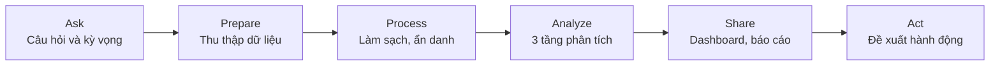

# Retail Revenue & Profitability Analysis

**Phân tích doanh thu và lợi nhuận của một cửa hàng bán lẻ hàng thiết yếu (gas, bếp gas, gạo) từ dữ liệu giao dịch thật.**

> **Trạng thái:** đang thực hiện, giai đoạn Ask (lập kế hoạch và làm việc với các bên liên quan). Chưa có kết quả phân tích. Các mục kết quả sẽ được cập nhật khi từng giai đoạn hoàn thành.

## Tổng quan

Dự án phân tích dữ liệu bán hàng của một cửa hàng gia đình kinh doanh gas, bếp gas và phụ kiện, gạo và một số mặt hàng tiêu dùng thiết yếu. Cửa hàng nhận thấy doanh thu, sản lượng và số khách có dấu hiệu chững lại trong vài năm gần đây, nhưng đây mới là cảm nhận chủ quan. Mục tiêu là đo đếm tình hình thực tế, xác định nguồn gốc của sự sụt giảm nếu có, và đề xuất các hướng hành động cụ thể.

Điểm khác biệt so với các dự án dùng dataset mẫu: dữ liệu đến từ một doanh nghiệp thật, có những đặc thù ngành như giá thương lượng riêng cho từng khách, vỏ bình gas, giao hàng tận nhà và mùa vụ theo Tết. Vì vậy dự án đặt quyền riêng tư dữ liệu lên hàng đầu: dữ liệu thật không được đưa lên repo.

## Bài toán kinh doanh

Câu hỏi đầu tiên không phải "vì sao giảm", mà là "có thật sự giảm không, giảm ở đâu và giảm bao nhiêu". Dự án trả lời các câu hỏi sau:

| # | Câu hỏi | Kỹ thuật chính |
| --- | --- | --- |
| 1 | Doanh thu và lợi nhuận có thật sự giảm qua 3 năm không? | So sánh cùng kỳ (YoY), tách mùa vụ STL |
| 2 | Giảm do mất khách, khách mua thưa hơn hay giá trị đơn thấp hơn? | Cây chỉ số doanh thu, Price – Volume – Mix |
| 3 | Nhóm hàng nào tạo ra lợi nhuận, nhóm nào kéo xuống? | ABC/Pareto theo lãi gộp |
| 4 | Khách nào đã rời bỏ và vì sao? | RFM, cohort retention |
| 5 | Cùng một sản phẩm nhưng khác giá giữa các khách, phần lợi nhuận bị mất là bao nhiêu? | Rò rỉ giá so với giá niêm yết |
| 6 | Giao hàng tận nơi có lời ở mọi khu vực không? | Lợi nhuận ròng trên mỗi đơn theo khu vực |
| 7 | Có dự đoán được khi nào khách cần thay gas không? | Phân tích chu kỳ mua, danh sách nhắc gọi hàng tuần |
| 8 | Doanh thu 6 tháng tới ra sao nếu giữ nguyên cách làm hiện tại? | Prophet hoặc SARIMA, đánh giá bằng MAPE |

## Quy trình thực hiện

Dự án đi theo quy trình phân tích dữ liệu sáu bước và phân tích theo ba tầng, từ tổng quan đến chi tiết.



- **Tầng 1, tổng quan:** có giảm không và giảm bao nhiêu (KPI, YoY, mùa vụ).
- **Tầng 2, phân rã:** giảm đến từ đâu (số khách × tần suất × giá trị đơn, cơ cấu lợi nhuận, chênh lệch giá).
- **Tầng 3, chi tiết:** nhóm khách, sản phẩm, khu vực và giai đoạn nào cần hành động (RFM, cohort, giỏ hàng, tồn kho, dự báo).

## Mô hình dữ liệu

Dữ liệu được tổ chức theo star schema trên DuckDB: các bảng sự kiện (`fact_sales`, `fact_purchases`, `fact_expenses`, `fact_cylinders`) nối với các bảng danh mục (`dim_product`, `dim_customer`, `dim_date`, `dim_price_list`). Bảng `dim_price_list` lưu lịch sử giá niêm yết theo ngày hiệu lực, làm mốc để đo chênh lệch giá thực tế bán cho từng khách. Chi tiết xem trong [kế hoạch dự án](docs/project-plan.md).

## Data Privacy & Ethics

Dữ liệu giao dịch chứa thông tin cá nhân của khách hàng (số điện thoại, địa chỉ) và thông tin kinh doanh nhạy cảm (giá nhập, doanh thu). Dự án áp dụng bốn lớp bảo vệ:

1. **Ẩn danh hóa:** tên và số điện thoại được thay bằng mã băm HMAC-SHA256 có khóa bí mật chỉ lưu trên máy cá nhân. Địa chỉ chỉ giữ đến cấp phường. Số tiền được nhân với một hệ số bí mật, giữ nguyên xu hướng và tỷ lệ phần trăm nhưng không lộ doanh thu thật.
2. **AI viết code, máy cá nhân chạy code:** khi dùng AI hỗ trợ, chỉ chia sẻ tên cột, kiểu dữ liệu, dữ liệu mẫu giả hoặc số liệu đã tổng hợp. Dữ liệu thật không được gửi cho AI.
3. **Cài đặt quyền riêng tư của công cụ AI:** tắt tùy chọn dùng hội thoại để huấn luyện mô hình, dùng chế độ Incognito cho nội dung nhạy cảm.
4. **Chỉ công khai dữ liệu tổng hợp nhân tạo:** repo chỉ chứa bộ dữ liệu synthetic có phân phối giống dữ liệu thật. Thư mục dữ liệu thật bị chặn bởi `.gitignore`, và có kiểm tra tự động trước mỗi lần commit.

Cách làm này tuân thủ tinh thần của Luật Bảo vệ dữ liệu cá nhân số 91/2025/QH15 (có hiệu lực từ 01/01/2026).

## Công nghệ

| Mục đích | Công cụ |
| --- | --- |
| Xử lý và phân tích | Python (pandas, scikit-learn, statsmodels, Prophet) |
| Truy vấn và mô hình hóa dữ liệu | SQL trên DuckDB |
| Khám phá dữ liệu | Jupyter Notebook |
| Dashboard | Streamlit |
| Sinh dữ liệu tổng hợp | Script Python (có thể dùng thư viện SDV) |

## Lộ trình

- [x] Lập kế hoạch dự án và bộ câu hỏi làm việc với các bên liên quan
- [ ] Giai đoạn 1: thu thập dữ liệu, soạn data dictionary
- [ ] Giai đoạn 2: ẩn danh hóa, sinh dữ liệu synthetic, dựng repo
- [ ] Giai đoạn 3: làm sạch dữ liệu, dựng star schema
- [ ] Giai đoạn 4: tổng quan KPI và phân rã doanh thu
- [ ] Giai đoạn 5: phân tích chi tiết (khách hàng, giá, khu vực, giỏ hàng)
- [ ] Giai đoạn 6: mô hình chu kỳ thay gas và dự báo
- [ ] Giai đoạn 7: dashboard
- [ ] Giai đoạn 8: báo cáo và đề xuất hành động

Dự kiến hoàn thành trước ngày 24/01/2027. Lịch chi tiết xem trong [kế hoạch dự án](docs/project-plan.md).

## Cấu trúc repo (dự kiến)

```
retail-profitability-analysis/
├── data/
│   ├── raw/             # dữ liệu thật, bị chặn bởi .gitignore, không có trên repo
│   └── synthetic/       # dữ liệu tổng hợp nhân tạo, công khai
├── sql/                 # tạo schema, truy vấn KPI
├── notebooks/           # 01_eda ... 06_forecasting
├── src/                 # anonymize.py, features.py, models.py
├── dashboard/           # app.py (Streamlit)
├── reports/             # hình ảnh và báo cáo insight
├── docs/
│   └── project-plan.md  # kế hoạch dự án chi tiết
└── README.md
```

Các thư mục trên sẽ được tạo dần theo từng giai đoạn.

## Cách chạy lại dự án

Sẽ được cập nhật khi có mã nguồn. Người dùng bên ngoài sẽ chạy toàn bộ pipeline trên bộ dữ liệu synthetic trong `data/synthetic/`.

## Kết quả chính

Sẽ được cập nhật sau giai đoạn 4 và 5. Phần này sẽ nêu các phát hiện kèm con số, ảnh chụp dashboard và các đề xuất hành động.

## Tài liệu

- [Kế hoạch dự án chi tiết](docs/project-plan.md): bối cảnh, câu hỏi kinh doanh, mô hình dữ liệu, phương pháp, công thức, lịch triển khai, rủi ro và tài liệu tham khảo.

## Tác giả

[@klongnguyen](https://github.com/klongnguyen)
