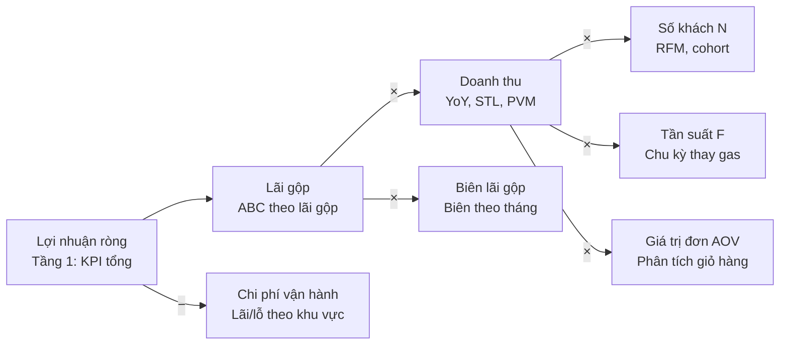
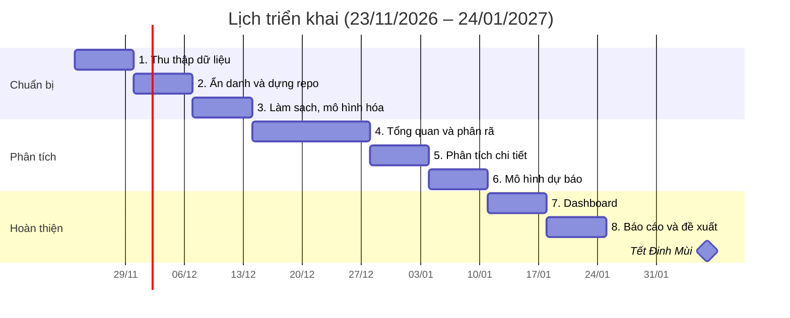

# Kế hoạch dự án: Phân tích Doanh thu & Lợi nhuận Bán lẻ (Gas – Bếp – Gạo)

Cập nhật lần cuối: 16/11/2026

## 1. Bối cảnh và lý do thực hiện

Dự án này nhằm kiểm chứng bằng dữ liệu nhận định rằng doanh thu, sản lượng và số khách hàng của cửa hàng đang chững lại và có xu hướng giảm trong vài năm gần đây. Hiện tại đây mới là cảm nhận chủ quan của chủ cửa hàng, chưa được đo đếm. Vì vậy câu hỏi đầu tiên không phải là "vì sao giảm", mà là "có thật sự giảm không, giảm ở đâu và giảm bao nhiêu".

Cửa hàng kinh doanh các mặt hàng thiết yếu gồm gas (bình 12 kg, 45 kg), bếp gas và phụ kiện (van, dây, kiềng), gạo và một số hàng tiêu dùng khác. Đây là nhóm hàng có nhu cầu ổn định, mua lặp lại theo chu kỳ. Nếu doanh thu giảm thì nguyên nhân thường nằm ở việc mất khách, khách mua thưa hơn, hoặc biên lợi nhuận bị thu hẹp, chứ hiếm khi do nhu cầu thị trường biến mất.

Kết quả của dự án phục vụ hai mục đích. Thứ nhất, giúp gia đình có cái nhìn từ tổng quan đến chi tiết về tình hình kinh doanh và chọn được hướng phát triển. Thứ hai, trở thành một dự án phân tích dữ liệu hoàn chỉnh trên GitHub, dùng dữ liệu đã được ẩn danh hóa.

## 2. Mục tiêu và câu hỏi kinh doanh

Mục tiêu chính là xác định được nguồn gốc của sự sụt giảm, nếu có. Sau đó đưa ra ít nhất ba hướng hành động cụ thể, đo được, áp dụng được trong 6 tháng tiếp theo. Mỗi câu hỏi dưới đây đi kèm một giả thuyết ban đầu. Dữ liệu sẽ xác nhận hoặc bác bỏ từng giả thuyết.

| Câu hỏi | Giả thuyết ban đầu | Cách kiểm chứng |
| --- | --- | --- |
| Doanh thu và lợi nhuận có thật sự giảm không? | Giảm nhẹ qua từng năm | So sánh cùng kỳ (YoY) theo tháng, loại bỏ yếu tố mùa vụ và Tết |
| Giảm do mất khách, khách mua thưa hơn hay giá trị đơn thấp hơn? | Mất khách là nguyên nhân chính | Tách doanh thu thành số khách × tần suất × giá trị đơn, xem thành phần nào giảm |
| Nhóm hàng nào đóng góp lợi nhuận nhiều nhất và nhóm nào đang kéo xuống? | Gạo bán nhiều nhưng biên mỏng; bếp và phụ kiện biên cao | Phân tích ABC/Pareto theo lãi gộp, không chỉ theo doanh thu |
| Khách hàng nào đã rời bỏ, và họ là ai? | Một phần khách quen chuyển sang đại lý khác hoặc bếp điện | RFM và phân tích cohort theo năm khách mua lần đầu |
| Giao hàng tận nơi có lời ở mọi khu vực không? | Khu vực xa đang lỗ sau chi phí giao | Lợi nhuận ròng trên mỗi đơn theo khu vực |
| Giá vốn tăng có làm biên lợi nhuận co lại không? | Giá nhập gas tăng nhưng giá bán chưa điều chỉnh kịp | So biên lãi gộp theo tháng với giá nhập |
| Có dự đoán được khi nào khách cần thay gas không? | Mỗi hộ có chu kỳ thay bình khá đều | Đo khoảng cách giữa các lần mua của từng khách, dự báo lần kế tiếp |
| Chênh lệch giá giữa các khách có đang làm mất lợi nhuận không? | Giá thương lượng riêng được giữ cố định theo từng khách, nên mức giảm tích tụ lâu dài và không tự điều chỉnh khi giá nhập đổi | So giá thực tế với giá niêm yết cùng ngày, tính phần lợi nhuận bị mất theo khách và theo sản phẩm |

## 3. Phạm vi và dữ liệu cần thu thập

Phạm vi phân tích đề xuất là 3 năm gần nhất (2024 đến tháng 11/2026). Khoảng này đủ dài để thấy xu hướng qua nhiều năm và tách được hiệu ứng mùa vụ. Nếu chỉ có dữ liệu 1 đến 2 năm, dự án vẫn làm được, nhưng phần so sánh cùng kỳ và dự báo sẽ kém tin cậy hơn.

Dữ liệu được tổ chức theo mô hình star schema: các bảng sự kiện (fact) ghi lại giao dịch, nối với các bảng danh mục (dimension) mô tả sản phẩm, khách hàng và thời gian. Nguồn có thể là phần mềm bán hàng, file Excel hoặc sổ ghi tay. Riêng sổ ghi tay sẽ cần nhập lại, nên có thể chỉ lấy mẫu một số tháng.

| Bảng | Nội dung chính | Mức độ cần thiết |
| --- | --- | --- |
| fact_sales | Ngày, mã hóa đơn, mã khách, mã sản phẩm, số lượng, giá bán thực tế, chiết khấu, có giao hàng hay không | Bắt buộc |
| fact_purchases | Ngày nhập, nhà cung cấp, mã sản phẩm, số lượng, giá nhập | Bắt buộc (để tính giá vốn) |
| fact_expenses | Tháng, loại chi phí (xăng xe, lương, mặt bằng, điện nước), số tiền | Nên có (để tính lợi nhuận ròng) |
| fact_cylinders | Xuất, thu hồi vỏ bình, tiền cọc vỏ | Tùy chọn (điểm khác biệt của ngành gas) |
| dim_product | Tên, nhóm hàng, quy cách, thương hiệu | Bắt buộc |
| dim_customer | Mã khách đã ẩn danh, loại khách (hộ gia đình, quán ăn, đại lý), khu vực đến cấp phường, ngày mua đầu tiên | Bắt buộc |
| dim_date | Ngày, tháng, quý, năm, ngày lễ, giai đoạn Tết âm lịch | Tự tạo |
| dim_price_list | Ngày hiệu lực, mã sản phẩm, giá niêm yết | Bắt buộc (mốc để so với giá thực tế) |

Nếu không có mã khách hàng (bán lẻ không ghi tên), các phần RFM, cohort và dự đoán chu kỳ thay gas sẽ chỉ áp dụng được cho khách giao hàng tận nhà. Với nhóm này, số điện thoại thường đã được ghi lại.

Cửa hàng đã có giá niêm yết và sổ sách ghi giá thực tế bán cho từng khách, nên có thể đo chênh lệch giá trực tiếp. Điều cần thêm là lịch sử giá niêm yết theo ngày hiệu lực, vì giá nhập đổi theo tháng. Nếu chưa có lịch sử này, giá niêm yết mỗi tháng được suy ra từ mức giá cao phổ biến nhất của từng sản phẩm. Từ nay nên ghi thêm lý do khi bán dưới giá niêm yết (mua nhiều, khách quen, thương lượng), để sau này phân biệt được giảm giá hợp lý với giảm giá tùy hứng.

## 4. Phương pháp phân tích

Phân tích đi theo ba tầng, từ tổng quan đến chi tiết. Tầng 1 trả lời câu hỏi "có giảm không và giảm bao nhiêu" bằng các chỉ số tổng. Tầng 2 tách doanh thu và lợi nhuận thành các thành phần để biết giảm đến từ đâu. Tầng 3 đi sâu vào từng sản phẩm, nhóm khách, khu vực và giai đoạn để tìm nguyên nhân cụ thể.

### Các công thức cốt lõi

Doanh thu được tách thành ba thành phần, mỗi thành phần gắn với một loại nguyên nhân khác nhau:

$$\text{Doanh thu} = N_{\text{khách}} \times F \times \text{AOV}$$

Trong đó N là số khách có mua trong kỳ, F là số đơn trung bình mỗi khách, AOV là giá trị trung bình mỗi đơn. N giảm nghĩa là mất khách, F giảm nghĩa là khách mua thưa hơn hoặc mua thêm ở nơi khác, AOV giảm nghĩa là giỏ hàng nhỏ hơn hoặc giá bán thấp hơn.

Đọc từ trái sang phải: yếu tố nào giảm ở cột phải sẽ kéo lợi nhuận ròng ở cột trái xuống theo.

$$\text{Biên lãi gộp (\%)} = \frac{\text{Doanh thu} - \text{Giá vốn hàng bán}}{\text{Doanh thu}} \times 100\%$$

$$\text{Lợi nhuận ròng} = \text{Lãi gộp} - \text{Chi phí vận hành}$$

Thay đổi doanh thu giữa hai năm được tách theo phương pháp Price – Volume – Mix. Cách này cho biết phần giảm do bán ít đi, do giá thay đổi, hay do cơ cấu hàng chuyển sang mặt hàng rẻ hơn:

$$\Delta \text{Doanh thu} = \underbrace{\sum_i (Q_{i,1} - Q_{i,0})\, P_{i,0}}_{\text{hiệu ứng sản lượng + cơ cấu}} + \underbrace{\sum_i (P_{i,1} - P_{i,0})\, Q_{i,1}}_{\text{hiệu ứng giá}}$$

Chênh lệch giá được đo bằng cách so mỗi dòng bán với giá niêm yết của đúng ngày đó. Phần chênh cộng dồn là mức rò rỉ giá của khách k đối với sản phẩm i:

$$\text{Rò rỉ giá}_{k,i} = \sum_{t} \left( P^{\text{niêm yết}}_{i,t} - P^{\text{thực tế}}_{k,i,t} \right) \times Q_{k,i,t}$$

Ví dụ, bình gas 12 kg niêm yết 480.000 đ bán 469.000 đ là chênh 11.000 đ, khoảng 2,3% giá niêm yết, và con số này lặp lại ở mỗi lần khách đó mua. Vì giá thương lượng được giữ cố định theo từng khách, bước đầu tiên là gán cho mỗi khách một mức giảm ổn định, tính bằng đồng và bằng phần trăm. Bước tiếp theo là kiểm tra khi giá nhập đổi thì mức giảm của họ giữ nguyên theo đồng hay theo phần trăm. Nếu giá bán cho khách quen không nhích theo giá niêm yết, biên lãi của nhóm khách đó bị bào mòn mỗi khi giá nhập tăng.

Với khách giao hàng tận nhà, ngày cần thay gas tiếp theo được dự báo từ trung vị khoảng cách giữa các lần mua trước đó:

$$\hat{t}_{\text{kế tiếp}} = t_{\text{gần nhất}} + \operatorname{median}(\Delta t_1, \Delta t_2, \ldots, \Delta t_k)$$

Nếu đã quá ngày dự báo khoảng 1,5 lần chu kỳ mà khách chưa mua, khách được đánh dấu là có nguy cơ rời bỏ. Ngưỡng 1,5 là giá trị khởi đầu và sẽ được hiệu chỉnh theo dữ liệu thật.

### Các module phân tích

| Tầng | Module | Câu hỏi trả lời | Kỹ thuật |
| --- | --- | --- | --- |
| 1 | Tổng quan KPI | Doanh thu, lãi gộp, số khách, sản lượng thay đổi ra sao qua 3 năm? | YoY theo tháng, đường trung bình trượt 12 tháng, tách mùa vụ (STL) [5] |
| 2 | Phân rã doanh thu | Giảm do số khách, tần suất hay giá trị đơn? | Cây chỉ số (driver tree), Price – Volume – Mix, biểu đồ thác nước |
| 2 | Cơ cấu lợi nhuận | Nhóm hàng nào tạo ra lợi nhuận, nhóm nào kéo xuống? | ABC/Pareto theo lãi gộp, ma trận doanh thu × biên lãi |
| 2 | Chênh lệch giá | Cùng một sản phẩm, khách nào mua giá nào, và phần lợi nhuận bị mất so với giá niêm yết là bao nhiêu? | Bậc giá theo khách, rò rỉ giá so với niêm yết, kiểm tra mức giảm theo đồng hay theo phần trăm khi giá nhập đổi, so mức giảm với tần suất mua và tỷ lệ rời bỏ |
| 3 | Khách hàng | Ai đã rời bỏ, ai là khách giá trị nhất, khách mới có ở lại không? | RFM, cohort retention theo năm mua đầu tiên |
| 3 | Chu kỳ thay gas | Khi nào khách cần gas, ai đang quá hạn? | Phân phối khoảng cách mua, danh sách nhắc gọi hàng tuần |
| 3 | Khu vực giao hàng | Khu vực nào lời, khu vực nào lỗ sau chi phí giao? | Lợi nhuận ròng trên đơn theo phường |
| 3 | Giỏ hàng | Mặt hàng nào hay được mua cùng nhau? | Market Basket Analysis (Apriori [7]: support, confidence, lift) |
| 3 | Tồn kho | Hàng nào đọng vốn, hàng nào hay hết? | Vòng quay tồn kho, số ngày tồn |
| 3 | Dự báo | Doanh thu 6 tháng tới nếu giữ nguyên cách làm hiện tại? | Prophet [6] hoặc SARIMA có biến Tết, đánh giá bằng MAPE |

### Công cụ

Xử lý và phân tích dùng Python (pandas, scikit-learn, statsmodels, Prophet) và SQL trên DuckDB. Notebook Jupyter dùng cho phần khám phá. Dashboard dựng bằng Streamlit để có link demo công khai, hoặc Power BI nếu muốn thể hiện kỹ năng BI.

## 5. Bảo vệ dữ liệu và sử dụng AI an toàn

Nguyên tắc xuyên suốt là dữ liệu thật không rời khỏi máy của chủ dự án. AI và GitHub chỉ nhìn thấy cấu trúc dữ liệu, dữ liệu đã ẩn danh hoặc dữ liệu tổng hợp. Số điện thoại và địa chỉ khách hàng là dữ liệu cá nhân theo Luật Bảo vệ dữ liệu cá nhân số 91/2025/QH15, có hiệu lực từ ngày 01/01/2026 [1]. Luật này có Điều 30 riêng về xử lý dữ liệu cá nhân bằng trí tuệ nhân tạo và điện toán đám mây [2].

**Lớp 1: Ẩn danh hóa ngay từ bước đầu.** Tên và số điện thoại khách được thay bằng mã băm HMAC-SHA256 có khóa bí mật, ví dụ KH_8f3a2c. Khóa này chỉ lưu trên máy của chủ dự án. Địa chỉ chỉ giữ đến cấp phường. Mọi số tiền được nhân với một hệ số bí mật. Cách này giữ nguyên xu hướng, tỷ lệ phần trăm và biên lợi nhuận, nhưng không ai biết doanh thu thật.

**Lớp 2: AI viết code, máy cá nhân chạy code.** Khi làm việc với AI, chỉ gửi tên cột, kiểu dữ liệu và vài dòng mẫu giả. AI viết code phân tích, người dùng chạy code trên dữ liệu thật tại máy. Nếu cần AI nhận xét kết quả, chỉ gửi số liệu đã tổng hợp (ví dụ doanh thu theo tháng đã nhân hệ số), không gửi từng hóa đơn.

**Lớp 3: Cài đặt quyền riêng tư của công cụ AI.** Với Claude gói cá nhân, tắt mục "Help improve Claude" trong Settings > Privacy để các cuộc trò chuyện mới không được dùng huấn luyện mô hình [3]. Với nội dung nhạy cảm, dùng thêm chế độ Incognito [4]. Nếu muốn tuyệt đối không đưa dữ liệu ra ngoài, có thể chạy mô hình mã nguồn mở ngay trên máy bằng Ollama, đổi lại chất lượng thấp hơn.

**Lớp 4: Chỉ công khai dữ liệu tổng hợp nhân tạo.** Repo GitHub chỉ chứa bộ dữ liệu synthetic được sinh ra có phân phối giống dữ liệu thật. Thư mục `data/raw/` được đưa vào `.gitignore` từ commit đầu tiên. Trước mỗi lần push, chạy một bước kiểm tra tự động (pre-commit hook) để chặn file có dạng số điện thoại hoặc file dữ liệu lớn.

README có mục "Data Privacy & Ethics" mô tả bốn lớp trên. Mục này vừa minh bạch với người đọc, vừa cho thấy trách nhiệm khi làm việc với dữ liệu thật.

## 6. Kế hoạch triển khai

Dự án dự kiến kéo dài 9 tuần, từ ngày 23/11/2026 đến ngày 24/01/2027, xong trước Tết Đinh Mùi (06/02/2027) khoảng hai tuần. Mốc này có chủ đích: danh sách khách cần nhắc thay gas và các đề xuất combo có thể áp dụng ngay trong mùa cao điểm Tết. Ngày bắt đầu có thể lùi lại tùy thời gian thực tế.

Giai đoạn 4 kéo dài hai tuần vì đây là phần trả lời câu hỏi chính: doanh nghiệp có thật sự đang giảm không.

Phân vai dựa trên nguyên tắc ở mục 5. Chủ dự án giữ và xử lý dữ liệu thật, đồng thời là người hiểu kinh doanh nhất để đánh giá insight. Claude viết code, thiết kế phân tích, dựng dashboard và soạn báo cáo dựa trên cấu trúc dữ liệu hoặc số liệu tổng hợp được cung cấp.

| Giai đoạn | Chủ dự án làm | Claude làm | Sản phẩm bàn giao |
| --- | --- | --- | --- |
| 1. Thu thập dữ liệu (23/11 – 29/11) | Gom dữ liệu từ phần mềm, Excel, sổ sách; gửi danh sách tên cột | Soạn data dictionary, chốt danh sách câu hỏi kinh doanh | Data dictionary, bản mô tả nguồn dữ liệu |
| 2. Ẩn danh và dựng repo (30/11 – 06/12) | Chạy script ẩn danh trên máy, giữ khóa bí mật | Viết anonymize.py, bộ sinh dữ liệu synthetic, cấu trúc repo, .gitignore, pre-commit | Repo GitHub ban đầu, bộ dữ liệu synthetic |
| 3. Làm sạch và mô hình hóa (07/12 – 13/12) | Giải thích các ngoại lệ (hàng tặng, trả hàng, nợ) | Viết SQL tạo star schema trên DuckDB, kiểm tra chất lượng dữ liệu | Các bảng fact/dim, báo cáo chất lượng dữ liệu |
| 4. Tổng quan và phân rã (14/12 – 27/12) | Chạy notebook, xác nhận số liệu khớp thực tế | Notebook KPI, YoY, STL, driver tree, Price – Volume – Mix | Kết luận: có giảm không, giảm ở thành phần nào |
| 5. Phân tích chi tiết (28/12 – 03/01) | Nhận diện khách rời bỏ, bổ sung bối cảnh | RFM, cohort, ABC, lợi nhuận theo khu vực, giỏ hàng | Danh sách nhóm khách, sản phẩm và khu vực cần hành động |
| 6. Mô hình (04/01 – 10/01) | Kiểm tra danh sách nhắc gas có hợp lý không | Chu kỳ thay gas, dự báo doanh thu 6 tháng, đo sai số | Danh sách nhắc gọi hàng tuần, dự báo có MAPE |
| 7. Dashboard (11/01 – 17/01) | Dùng thử và góp ý | Dựng Streamlit, deploy bản chạy dữ liệu synthetic | Link dashboard công khai |
| 8. Báo cáo và đề xuất (18/01 – 24/01) | Chọn hướng đi, lên kế hoạch áp dụng Tết | Viết báo cáo insight, README, sơ đồ kiến trúc | Báo cáo cho gia đình, repo hoàn chỉnh |

## 7. Đầu ra kỳ vọng và hướng phát triển

Dự án có bốn sản phẩm đầu ra. Thứ nhất là dashboard tương tác, xem được từ tổng quan đến chi tiết theo nhóm hàng, khách hàng, khu vực và thời gian. Thứ hai là báo cáo insight dành cho gia đình, viết bằng ngôn ngữ kinh doanh, không dùng thuật ngữ kỹ thuật. Thứ ba là danh sách khách cần nhắc thay gas, cập nhật hàng tuần. Thứ tư là repo GitHub hoàn chỉnh với README, notebook, SQL, dashboard và dữ liệu synthetic.

Hướng phát triển cụ thể chỉ được chốt sau khi có kết quả phân tích. Bảng dưới đây chuẩn bị sẵn các hướng hành động ứng với từng kết quả có thể xảy ra, kèm chỉ số để đo hiệu quả sau khi áp dụng.

| Nếu phân tích cho thấy | Hướng hành động | Chỉ số theo dõi |
| --- | --- | --- |
| Số khách giảm, nhất là khách quen lâu năm | Gọi nhắc thay gas theo chu kỳ, chương trình khách thân thiết (ví dụ mua 10 bình tặng 1 lần kiểm tra bếp miễn phí) | Tỷ lệ khách quay lại, số khách có nguy cơ rời bỏ |
| Khách vẫn còn nhưng mua thưa hơn | Kiểm tra đối thủ cạnh tranh trong khu vực, cải thiện tốc độ giao hàng, kênh đặt qua Zalo | Số đơn trên mỗi khách mỗi năm |
| Giá trị đơn giảm | Bán kèm theo kết quả phân tích giỏ hàng (gas kèm gạo, bếp kèm van và dây) | AOV, tỷ lệ đơn có từ 2 mặt hàng trở lên |
| Biên lãi co lại do giá nhập tăng | Điều chỉnh giá bán kịp thời, đàm phán lại với nhà cung cấp, đẩy nhóm hàng biên cao | Biên lãi gộp theo tháng |
| Một số khu vực giao hàng bị lỗ | Thu phí giao cho đơn nhỏ ở khu vực xa, gom đơn theo tuyến | Lợi nhuận ròng trên đơn theo khu vực |
| Nhóm quán ăn mang lại lợi nhuận cao | Mở rộng tệp khách quán ăn, bếp ăn tập thể, có giá sỉ và công nợ rõ ràng | Số khách doanh nghiệp, doanh thu từ nhóm này |
| Hàng tồn lâu, đọng vốn | Giảm nhập mặt hàng chậm, xả hàng trước Tết | Số ngày tồn kho, vòng quay tồn kho |
| Giá thực tế giữa các khách chênh nhiều và không theo quy tắc rõ ràng | Lập bảng giá theo bậc (số lượng, loại khách, hình thức giao), quy định mức giảm tối đa và người duyệt; rà lại các khách đang trả giá thấp nhất | Mức rò rỉ giá, số khách trả dưới ngưỡng, biên lãi gộp theo nhóm khách |
| Giá nhập tăng nhưng giá bán cho khách quen không đổi | Điều chỉnh giá khách quen theo giá niêm yết với lộ trình báo trước, giữ mức giảm theo phần trăm thay vì số tiền cố định | Biên lãi gộp theo khách, số khách rời bỏ sau khi điều chỉnh giá |

## 8. Rủi ro và cách xử lý

Rủi ro lớn nhất là chất lượng và độ đầy đủ của dữ liệu gốc. Nên dành tuần đầu tiên để kiểm tra xem dữ liệu hiện có trả lời được những câu hỏi nào, trước khi viết bất kỳ phân tích nào.

| Rủi ro | Ảnh hưởng | Cách xử lý |
| --- | --- | --- |
| Dữ liệu ghi tay, thiếu hoặc không thống nhất giữa các năm | Không so sánh được cùng kỳ, kết luận sai | Chuẩn hóa danh mục sản phẩm trước; với giai đoạn ghi tay chỉ nhập số liệu tổng theo tháng |
| Không có mã khách cho đơn bán lẻ tại quầy | Không làm được RFM, cohort cho toàn bộ khách | Phân tích khách trên nhóm giao hàng; từ nay ghi số điện thoại khi bán |
| Thiếu giá nhập hoặc chi phí vận hành | Chỉ tính được doanh thu, không tính được lợi nhuận | Dùng giá nhập trung bình theo tháng từ hóa đơn nhà cung cấp; ước lượng chi phí giao trên mỗi chuyến |
| Lộ dữ liệu thật lên GitHub | Vi phạm quyền riêng tư khách hàng, lộ thông tin kinh doanh | .gitignore từ đầu, pre-commit hook, repo để private cho đến khi kiểm tra xong |
| Yếu tố bên ngoài (giá gas thế giới, đối thủ mới, bếp điện) không có trong dữ liệu | Nhầm nguyên nhân bên ngoài thành lỗi nội bộ | Ghi lại mốc thời gian các sự kiện bên ngoài và đối chiếu với biểu đồ |
| Dự báo kém chính xác do ít dữ liệu | Quyết định dựa trên con số sai | Báo cáo dự báo kèm khoảng tin cậy và MAPE, coi dự báo là tham khảo |
| Sổ sách không ghi lý do giảm giá | Khó phân biệt giảm giá hợp lý (mua nhiều) với giảm giá tùy hứng | Dùng số lượng và loại khách để giải thích phần giảm giá; từ nay thêm cột lý do khi ghi sổ |

## Tài liệu tham khảo

[1] Quốc hội nước CHXHCN Việt Nam, *Luật Bảo vệ dữ liệu cá nhân*, Luật số 91/2025/QH15, ngày 26/06/2025. [Online]. Available: <https://thuvienphapluat.vn/documents/law.aspx?id=Q%3DpJMU5qSTTm>. Accessed: Nov. 16, 2026.

[2] Báo Lao Động, "Xử lý dữ liệu cá nhân bằng AI phải phân loại theo mức độ rủi ro," *laodong.vn*. [Online]. Available: <https://news.laodong.vn/cong-nghe/xu-ly-du-lieu-ca-nhan-bang-ai-phai-phan-loai-theo-muc-do-rui-ro-1634865.ldo>. Accessed: Nov. 16, 2026.

[3] MacRumors, "Anthropic will now train Claude on your chats, here's how to opt out," Aug. 28, 2025. [Online]. Available: <https://www.macrumors.com/2025/08/28/anthropic-claude-chat-training>. Accessed: Nov. 16, 2026.

[4] DeleteMe, "Claude privacy settings guide." [Online]. Available: <https://joindeleteme.com/ai-privacy-settings/claude-privacy-settings-guide/>. Accessed: Nov. 16, 2026.

[5] R. B. Cleveland, W. S. Cleveland, J. E. McRae, and I. Terpenning, "STL: A seasonal-trend decomposition procedure based on loess," *J. Official Statistics*, vol. 6, no. 1, pp. 3–73, 1990.

[6] S. J. Taylor and B. Letham, "Forecasting at scale," *The American Statistician*, vol. 72, no. 1, pp. 37–45, 2018.

[7] R. Agrawal and R. Srikant, "Fast algorithms for mining association rules," in *Proc. 20th Int. Conf. Very Large Data Bases (VLDB)*, Santiago, Chile, 1994, pp. 487–499.
